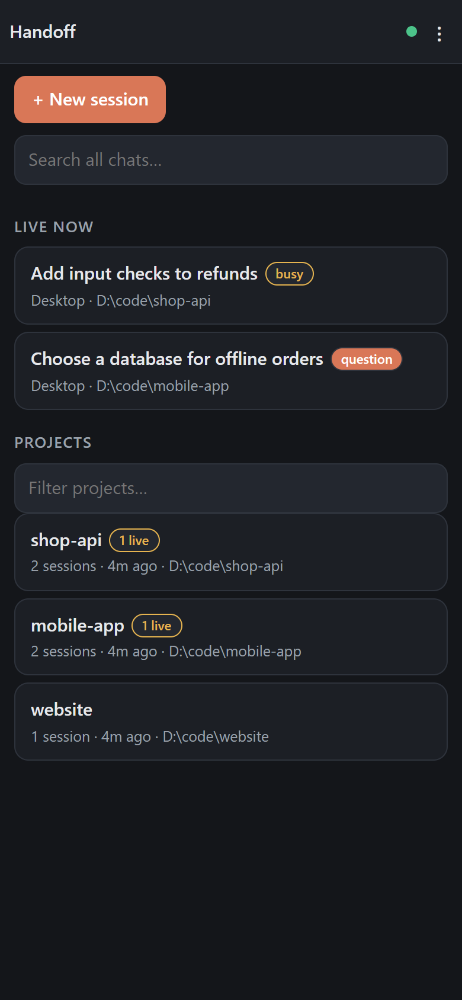
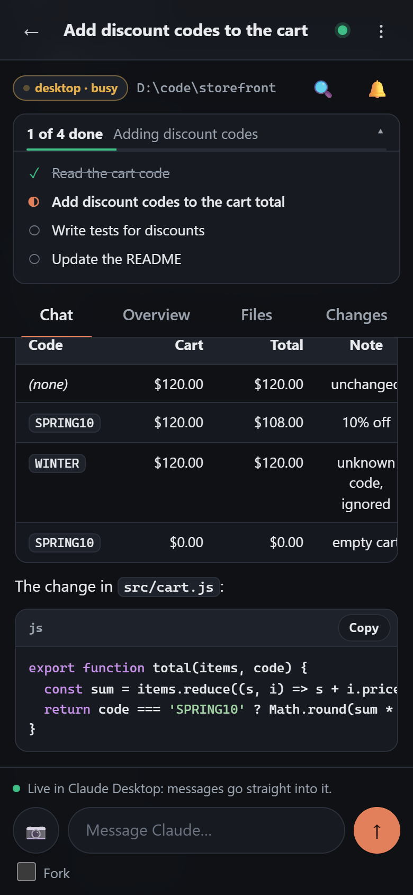
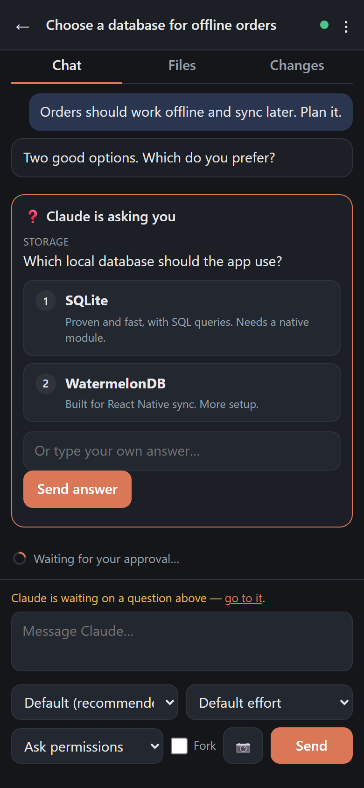
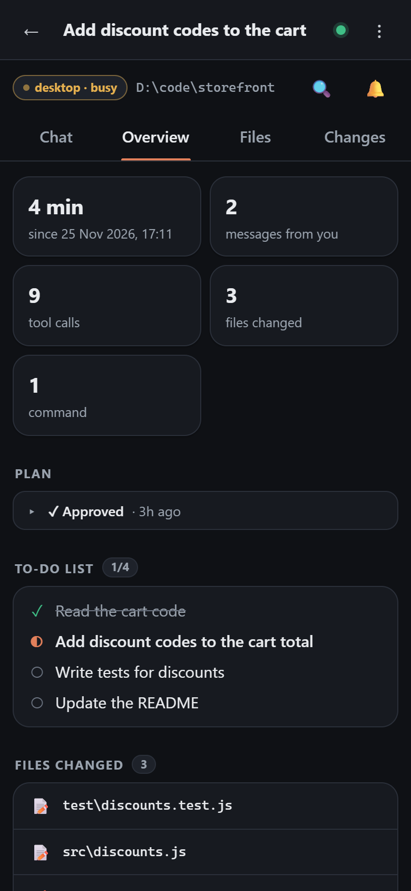
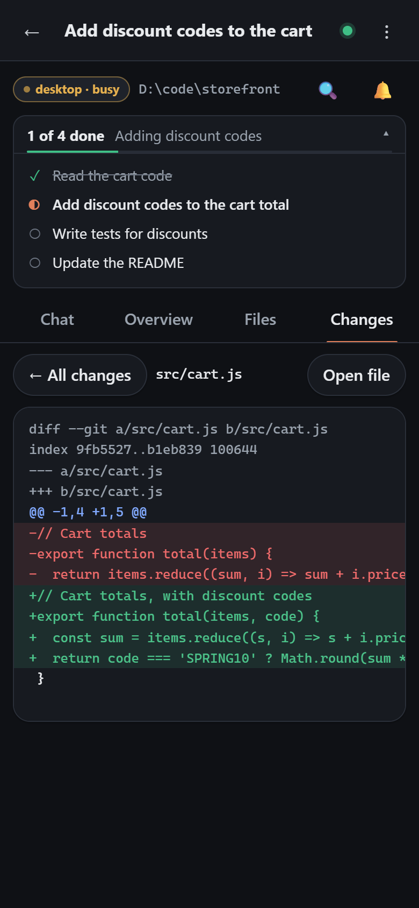
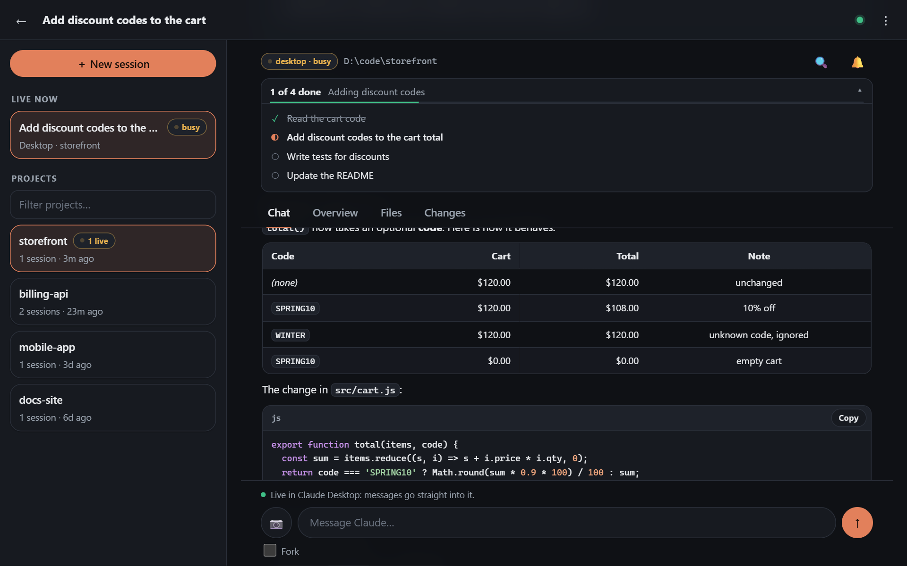

# Handoff

[](https://github.com/mmehran/handoff/actions/workflows/ci.yml)

**Self-hosted remote control for Claude Code.** Handoff runs on the computer where you use Claude Code and lets you reach it from your phone or any other browser. You can browse every project and session, watch Claude work live, send prompts, answer its questions, and approve tools. It can also send you WhatsApp messages when a session needs you.

And it has an **API**, so your own programs, scripts and phone shortcuts can use the Claude Code on your computer too, including from any OpenAI-compatible chat app.

The web app, the WhatsApp alerts and the API are separate parts: use any one of them on its own, or any mix. With WhatsApp alerts alone, there's no password, no tunnel and no open port.

It's a small Node.js server with no npm dependencies. It listens on `127.0.0.1` only and reaches the internet through a Cloudflare tunnel.

<p align="center">
  
  
  
  
  
</p>
<p align="center">
  
</p>

> Handoff is an independent open-source project. It is not affiliated with or endorsed by Anthropic. "Claude" and "Claude Code" are trademarks of Anthropic.

## What it does

- **Browse everything.** See every project and session from Claude Desktop, the CLI and IDEs, with full history: messages, tool calls and results.
- **Watch live.** Sessions open on your computer show up with busy, waiting or idle status, and messages stream in as Claude works. No refreshing.
- **Send prompts anywhere:**
  - type into a session that's open on your computer and it appears there in real time
  - continue an old session in place, or fork it
  - start a new session in any folder: type it, tap a recent one, or browse the computer's drives and folders (and make a new folder for a new project)
  - start it in its own git worktree, so sessions on one project don't edit the same files
- **Same choices as Claude Desktop.** The model list comes from your installed Claude Code, with each model's effort levels and the permission modes (Ask, Accept edits, Plan, Auto; Bypass only if you allow it).
- **Attach photos.** Snap a screenshot or photo on your phone and send it with your prompt (up to 4, scaled down on the phone first).
- **Approve tools from your phone.** Requests like "Allow Bash: npm test?" pop up with Allow and Deny buttons, in the app or right on the notification.
- **Answer Claude's questions.** When Claude asks a multiple-choice question, you see the options and tap one.
- **Approve plans.** Claude's plan shows in full; approve it, approve it and let Claude make edits without asking, or send it back with what to change.
- **Follow Claude's to-do list.** The checklist Claude keeps is pinned at the top of the chat: how far along it is and what it's doing now.
- **See what a session did.** An Overview tab per chat: how long it ran, the files Claude changed, the commands it ran (and whether they worked), its plan, to-do list and sub-agents. Open any sub-agent run to see its own messages and tool calls.
- **Chained prompts.** Type the next step and tap **Then**: it waits until Claude has finished, then goes in by itself, one after another ("run the tests", then "commit the changes"). Works with the page closed, for chats in Claude Desktop too. A question from Claude holds the next step, an error pauses the chain, and you can reorder, pause or clear the steps. The "finished" alert comes after the last one.
- **Quick replies.** "Continue", "Yes, go ahead", "Run the tests" and your own, one tap each, while Claude is waiting for you.
- **Readable answers.** Tables, lists, links and code blocks (coloured, with a Copy button) show properly on a phone.
- **Preview the app you're building (optional).** Open the dev server Claude is working on (localhost:3000, a Vite or Next.js app) on your phone, on its own address behind its own sign-in, with live reload. Handoff lists the ports the chat mentions and the web apps running on the computer. See [App preview](docs/preview.md).
- **Browse the project's files (optional).** A Files tab in every session shows its folder: find files by name, read code with colouring, preview Markdown, view images and download any file.
- **See what Claude changed (optional).** A Changes tab lists the project's uncommitted git changes and shows each file's diff, with line numbers. Both tabs are off until you set `HANDOFF_FILE_BROWSER=true`.
- **Commit and push from your phone.** Tick the files, write a commit message or let Claude write it, commit, then push; the hosting site's pull request link opens with a tap. Discard one file's changes if Claude got it wrong (a copy is kept for 30 days). `HANDOFF_GIT_ACTIONS=false` keeps the Changes tab look-only.
- **Comment on the diff.** Tap any line to leave Claude a comment, the way you would in a code review, then send them all at once. Claude gets each comment with its file, line and code.
- **Usage and limits.** How much of your plan's current 5-hour session and this week is used, and when each resets, as Claude Code reports it (with a Check now button). Tokens and an estimated API-price cost per day, model, project and chat, from every transcript on the computer. See [Usage and limits](docs/usage.md).
- **Laptop status and keep awake.** Battery, how soon the computer would sleep by itself and what the lid does. Keep it awake while Claude works (and 10 minutes after, for your reply), always, or not at all, without changing any power setting. See [Laptop](docs/laptop.md).
- **Search every chat.** One search box finds words in all your prompts and Claude's replies, across every project; each session can be searched on its own, and a hit opens in context.
- **Remember me.** Tick it when you sign in on your own phone and it stays signed in for 30 days.
- **Phone notifications.** Turn them on per device from the ⋮ menu and get the same alerts as notifications, even with the app closed. No WhatsApp, no account, nothing extra to install (on iPhone, add Handoff to the Home Screen first).
- **WhatsApp alerts (optional).** Get a message when a session needs approval, asks a question, is waiting, finishes or fails. Reply `yes`/`no` or an option number to answer straight from WhatsApp. Set quiet hours (one summary afterwards) or mute individual projects. This uses a self-hosted sender built on the open-source [Baileys](https://github.com/WhiskeySockets/Baileys) library, so there's no paid API.
- **An API for your own programs (optional).** Send a prompt and get the answer, or stream it. Pick a session and continue it with its context, or ask it something without changing it. Attach photos and files, and choose the model and effort. Approve what Claude wants to do, compare 2–3 models side by side, and get a webhook when a task ends. It has an OpenAI-compatible endpoint for chat apps and SDKs, a Swagger page with every endpoint, a "Try it" page in the web app, and ready-made Python, JavaScript and command-line clients. Keys have their own permissions, projects and limits. See [the API](docs/api.md).
- **Works on a phone, tablet or computer.** Light and dark themes (or follow the system). On a phone the chat's status, actions and tabs stay pinned at the top; on a tablet or computer, sessions and projects stay in a sidebar. Install it to the home screen as an app: long-press its icon for New session or Search, and share text, links or photos to it from other apps (Android) to start a session.

## Choose what to run

| Part | What you get | Needs | Turned on by |
|---|---|---|---|
| **Web app** | Everything above, from your phone or any browser, plus phone notifications | A password (`npm run setup`); a tunnel to reach it from your phone | `HANDOFF_WEB=true` (default) |
| **WhatsApp alerts** | A message when a session needs you; reply to answer or approve | Docker, a second WhatsApp number | `HANDOFF_WHATSAPP_ENABLED=true` |
| **API** | Your programs and shortcuts send prompts and get answers; OpenAI-compatible too | API keys; a tunnel to reach it from elsewhere | `HANDOFF_API=true` |

Use any one, or any mix. `npm run setup` asks which you want and sets up only those, and `npm start` starts only those. Details and every combination: [Choosing what to run](docs/services.md).

| You want | Guide | Needs |
|---|---|---|
| The web app, now, free, no domain | [Quick tunnel (random URL)](docs/setup-quick-tunnel.md) | `cloudflared` |
| The web app at a permanent address like `https://claude.example.com` | [Your own domain on Cloudflare](docs/setup-own-domain.md) | A domain on Cloudflare (free plan is fine) |
| WhatsApp alerts as well | [WhatsApp notifications](docs/whatsapp.md) | Docker, a second WhatsApp number |
| **Only** WhatsApp alerts: no web app, no tunnel, no password | [WhatsApp alerts only](docs/whatsapp-only.md) | Docker, a second WhatsApp number |
| Your own programs, scripts, phone shortcuts or chat apps | [The API](docs/api.md) | An API key |

Also useful:
- [Configuration reference](docs/configuration.md): every `.env` setting
- [Start automatically](docs/autostart.md) on Windows, macOS or Linux
- [Security model](docs/security.md)
- [Contributing](CONTRIBUTING.md) and the [changelog](CHANGELOG.md)

## Quick start

You need [Node.js 20+](https://nodejs.org) and [Claude Code](https://github.com/anthropics/claude-code) installed and signed in (`claude auth login`).

```bash
git clone https://github.com/mmehran/handoff.git
cd handoff
npm run setup        # asks which parts you want; for the web app, a password and 2FA
```

This quick start is for the web app. For WhatsApp alerts only, follow [WhatsApp alerts only](docs/whatsapp-only.md) instead.

Install `cloudflared` (other systems: [releases](https://github.com/cloudflare/cloudflared/releases)):

```bash
winget install --id Cloudflare.cloudflared      # Windows
```

```bash
brew install cloudflared                        # macOS
```

Then start it:

```bash
npm start
```

The console prints a `https://<random-words>.trycloudflare.com` address, and also saves it to `data/public-url.txt`. Open it on your phone and sign in. That's it.

For a local-only test without a tunnel, run `npm run start:local` and open http://127.0.0.1:7860.

There are no runtime npm packages to install. The WhatsApp sender is the only part with dependencies, and it runs in its own Docker container.

## How it works

```
 phone / other PC ──HTTPS──▶ Cloudflare ──tunnel──▶ cloudflared ──▶ Handoff (127.0.0.1:7860)
                                                                      │
                     reads ~/.claude/projects/*.jsonl (history) ◀─────┤
                     reads ~/.claude/sessions/*.json (what's live) ◀──┤
                     runs `claude -p --input-format stream-json` ◀────┤  sessions it drives
                     writes to a running session's local inbox ◀──────┘  sessions open on your computer
```

- **History** is read straight from Claude Code's own files, and only read. Handoff never changes your Claude settings or rewrites transcripts.
- **Sending a prompt** depends on where the session is:

  | Session | What happens |
  |---|---|
  | Open on your computer right now (Desktop/CLI) | Delivered live into that session through Claude Code's local messaging inbox, so it appears on screen in real time. Its tool approvals stay on your computer. |
  | Not running anywhere | Resumed in place (same session ID) with `claude -p --resume`. Next time you open it in Claude Desktop, the new turns are there. |
  | Started from Handoff and still running | Sent straight to that process. Tool approvals come to your phone. |
  | "Fork" ticked | `--fork-session`: a new copy with the full history; the original is untouched. |

- **Live updates** use Server-Sent Events. Cloudflare quick tunnels buffer event streams, so when a stream stalls the page falls back to polling for new lines every 2 s and the status dot turns yellow.

## Settings

All settings live in `.env`; see [`.env.example`](.env.example) and the [configuration reference](docs/configuration.md). `.env` is git-ignored, and nothing secret is stored anywhere else. The setup commands write it for you:

| Command | Writes |
|---|---|
| `npm run setup` (or `-- --services web,whatsapp` to skip the first questions) | `HANDOFF_WEB`; for the web app `HANDOFF_PASSWORD_HASH`, `HANDOFF_TOTP_SECRET`; for WhatsApp alerts the same as `setup:whatsapp` below |
| `npm run setup:domain` | `HANDOFF_TUNNEL=cloudflare`, `HANDOFF_PUBLIC_HOSTNAME`, `HANDOFF_CLOUDFLARE_TUNNEL_TOKEN` |
| `npm run setup:whatsapp` (asks for the receiving number, or pass `-- --to +15551234567`) | `HANDOFF_WHATSAPP_ENABLED`, `HANDOFF_WHATSAPP_TO`, `HANDOFF_WHATSAPP_TOKEN` |
| `node scripts/api-key.js create --name "…"` (also `list`, `revoke`) | an API key, hashed in `data/api-keys.json` (not in `.env`) |

## Commands

| Command | |
|---|---|
| `npm start` | The parts turned on in `.env`: the web app with the tunnel chosen by `HANDOFF_TUNNEL`, WhatsApp alerts, or both |
| `npm run start:local` | The same, without the tunnel: the web app at http://127.0.0.1:7860 |
| `npm run whatsapp-only` | `npm start` with the web app off, whatever `.env` says (kept for older setups) |
| `npm test` | Tests. They use a fake `~/.claude` and a fake `claude` CLI, so they never touch your data. |
| `docker compose up -d --build` | WhatsApp sender (optional) |

## Platform support

Developed and used daily on **Windows 11**: Claude Desktop, Claude Code CLI, cloudflared and Docker Desktop. The code is cross-platform Node.js, and live delivery into running sessions uses Unix sockets on macOS/Linux. But macOS and Linux are **not tested yet**, so reports and fixes are welcome.

## Claude's built-in Remote Control

Claude Code also has an official Remote Control feature (`claude --remote-control`, or the toggle in Claude Desktop). It drives one running session from claude.ai or the Claude app, with no tunnel. Handoff is self-hosted and covers all projects and history: you can start sessions in any folder, approve tools from any browser, and get WhatsApp alerts. Use whichever fits, or both.

## License

[MIT](LICENSE)
